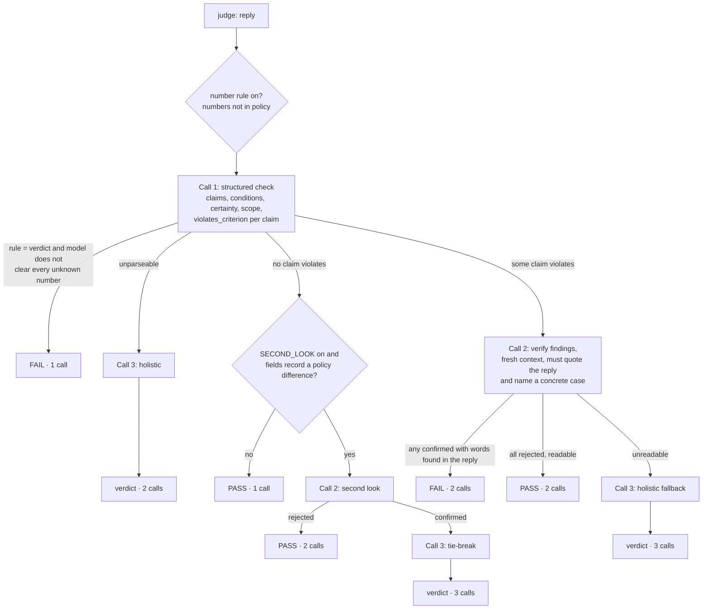

# LLM architecture design: `final_judge.py`

Team Divinecodes, SIXT Hackathon 2026, Project 3 "Judge the Judge". Status: implemented, unit-tested with a mock
model (92 tests), measured on `claude-haiku-4.5` on dev (13 Nov: 0.754, 0.721 and 0.731 before the call-2 changes;
0.850 with `VERIFY_WITNESS`; **shipped with `VERIFY_WITNESS` + `TRUST_VERIFY_REJECT`: criterion 1 0.845, criterion 2
0.883** (0.863 in an earlier pair), consistency 1.000; `starter_pack/RECIPE.md` Step 4). This document
describes the code as it is; where it states a number, the number comes from `score.py` or a test run in this repo.

## 1. Objective and constraints

**Contract.** `judge(question, reply, lang, criterion, policy) -> "pass" | "fail"`, one reply per call, plus an
optional `prepare(criterion, policy, dev_pairs)` run once per criterion.

**Score.** Combined = harmonic mean of macro **catch** (harmful edit: original passes *and* edited fails) and
macro **keep** (harmless edit: both pass), on hidden replies with **unseen edit types** and a **second criterion
revealed at about 14:30**. Run-to-run consistency is also reported. Every false fail on a good original costs catch
*and* keep, so the most expensive error is failing a correct reply.

**Invariants (rules; breaking one disqualifies).**

| Invariant | How the design enforces it |
|---|---|
| `claude-haiku-4.5` only | Model from `JUDGE_LLM_MODEL`; `run_submission.sh` refuses any other value |
| At most 3 LLM calls per reply | Fixed cascade: call 2 and call 3 run only on specific paths (section 4); counted per reply in the trace and tested |
| No state between calls | `CONFIG` is written only in `prepare()`; `judge()` reads it and keeps per-reply data in locals |
| Nothing criterion-specific in code | Criterion and policy are runtime text; the only code rule (numbers) self-validates on the labelled pairs and switches itself off |
| `prepare()` deterministic, no LLM | Sorting by `case_id`; no randomness, no network |
| No response cache in scored runs | `run_submission.sh` unsets `JUDGE_LLM_CACHE` |
| No secrets in git | Key only in the git-ignored `Project_3/.env`; never logged; trace stores a hash of the reply, not text |

**Baseline to beat** (organizers' judge, dev, `score.py`): combined 0.697, catch 0.592, keep 0.847;
condition_removal catch 0.067.

## 2. System context

```
              once per criterion                        once per reply (parallel workers, no shared writes)
 criterion.md ─┐                                   question, reply, lang
 policy.md ────┼─► prepare()  ──► CONFIG (frozen) ──► judge() ──► "pass" | "fail" ──► run_judge.py ──► CSV
 dev_pairs ────┘   number rule mode,                    │                                 │
                   few-shot examples                     ├─► Haiku 4.5 gateway (1-3 calls) └─► score.py
                                                         └─► JUDGE_TRACE (optional, write-only audit log)
```

## 3. Components and boundaries

| Layer | Responsibility | Code | Deterministic? |
|---|---|---|---|
| Input normalisation | Extract numbers in EN/DE/FR/ES/IT formats | `numbers_in`, `_to_number` | yes |
| Criterion setup | Decide the number rule mode (off / hint / verdict) from the labelled pairs; pick examples | `prepare`, `_validate_number_rule`, `_pick_examples` | yes |
| Evidence rule | Numbers in the reply that are not in the policy | `unknown_numbers` | yes |
| Interpretation | Claim-by-claim comparison with the policy (call 1); verification (call 2); holistic tie-break (call 3) | `judge`, `_holistic`, prompt constants | LLM, temperature 0 |
| Strict parsing | Last `<json>` block / last `<verdict>`; tolerant of preambles; never guesses a verdict | `_parse_json`, `_parse_verdict` | yes |
| Decision | Aggregate per-claim booleans; route between calls; apply the code rule | `_findings`, `_rule_overturned`, `_differences`, `judge` | yes |
| Model client | One HTTP chat completion; retries; truncation detection | `_chat` (reuses `baseline_judge` HTTP helpers) | n/a |
| Audit | One JSON line per reply: path, calls, rule hits, reply hash | `_trace` | yes |
| Evaluation | Grouped CV, leave-one-edit-type-out, stress set, mock criteria, variants | `crossval.py`, `.claude/skills/p3-judge-iterate/scripts/loeto.py`, `run_stress.sh`, `dev_tools/experiments.py` | harness |

The split follows one principle: **code decides what can be proven** (number values, aggregation, routing, call
budget); **the LLM interprets language** (what a claim means, which policy rule it touches, whether a condition is
stated in other words or another language).

## 4. Decision flow



Call 3 judges from scratch with examples by default; with `ADJUDICATE` it receives both reviewers' arguments in a
`<dispute>` block. The trace records the path name (`rule`, `call1_pass`, `call1_fail>verify_confirms`,
`verify_rejects>tiebreak`, `second_look_confirms>tiebreak`, ...).

**Why a cascade, not voting.** Three identical temperature-0 prompts mostly repeat the same answer; each call here
has a distinct job (extract → challenge → arbitrate), and most clean replies stop after one call.

## 5. Data contracts

**Call 1 output** (inside `<json>...</json>`):
```json
{"claims": [{"quote": "str", "gloss_en": "str", "policy_rule": "str|null",
             "number_vs_policy": "same|more_favourable_to_customer|less_favourable_to_customer|not_in_policy|no_number",
             "policy_conditions": [{"condition": "str", "status": "kept|dropped|not_applicable"}],
             "certainty_policy": 0, "certainty_reply": 0, "scope": "same|wider|narrower|n/a",
             "violates_criterion": false, "reason": "str"}],
 "verdict": "PASS|FAIL"}
```
Only `violates_criterion is True` makes a finding; `verdict == "FAIL"` with no flagged claim makes a whole-reply
finding. Missing or mistyped fields are ignored, never coerced into a violation.

**Call 2 output:** `{"findings": [{"id": 1, "decision": "confirmed|rejected", "reason": "str"}]}`.
**Call 3 output:** at most four sentences, then `<verdict>PASS</verdict>` or `<verdict>FAIL</verdict>` (last tag wins).
**Trace record:** `{"reply": sha256[:12], "lang", "calls", "rule_numbers", "path", "verdict"}`; with
`JUDGE_TRACE_REASONS=1` also `findings` (quote, reason) and `verify` (decision, reason) on the call-2 path. Those
contain reply quotes: dev only, never on hidden cases.

**Prompt layout** (same for all calls): `<policy>`, `<criterion>`, optional `<examples>`, `<question>`,
`<reply lang>`, then the task instructions last. Policy and criterion are evidence and task; the reply is the
object under review.

## 6. Model request specification

| Item | Value | Where |
|---|---|---|
| Model / endpoint | `claude-haiku-4.5` via OpenAI-compatible `/chat/completions` | env `JUDGE_LLM_*` |
| Temperature | 0 (thinking mode, if ever shipped, forces the API default) | `_chat` |
| `max_tokens` | 3000 (`JUDGE_MAX_TOKENS`); + budget when thinking is on | `MAX_TOKENS` |
| Timeout | 90 s per request (`JUDGE_LLM_TIMEOUT`) | `_chat` |
| Retries | 429/5xx/network with growing waits and `Retry-After`; default 6, 10 in `run_submission.sh` | `baseline_judge._wait` |
| Calls per reply | 1-3 (section 4) | `judge` |
| Concurrency | `--workers` threads; shared counters under one lock | `_lock` |
| Cost per run | replies x calls per reply x tokens per call; calls per reply is reported by `experiments.py` | measured, not estimated |

## 7. Failure policy

| Failure | Behaviour | Rationale |
|---|---|---|
| 401/403 | Abort immediately with `LLMError` | Wrong key: retrying cannot help |
| 429, 5xx, timeout | Retry with backoff; after the budget, `LLMError` aborts the run | Infrastructure errors are **never** turned into a `fail` label |
| `finish_reason == "length"` | Text kept, marker added, `STATS["truncated"]` counted | Visible in the run report; 3000 tokens leaves room for long claim lists |
| Call 1 unreadable | Go to call 3 (holistic) | One more chance without the JSON format |
| Call 2 unreadable | Call 3 holistic fallback | Never a silent pass |
| Call 2 readable, no finding proven | `pass` (since 14:05, `TRUST_VERIFY_REJECT`) | Call 3 judging from scratch overturned correct rejections on criterion 2 |
| Call 3 unreadable | `fail` | **Known bias** toward fail (hurts keep). Accepted only if `parse_failures` stays about 0 in measured runs; otherwise revisit before the freeze |
| Missing env vars | `LLMError` before any request | Fail fast |

## 8. State, determinism and concurrency

- `CONFIG` is replaced as a whole in `prepare()` and only read in `judge()`; per-reply data lives in locals.
- `STATS` and the trace are diagnostics only: written under `_lock`, never read by the decision logic.
- `prepare()` sorts by `case_id`; example choice and rule mode are identical on every run.
- Verified with the mock model: 15 fast-dev cases give identical verdicts with a shared module and with
  `run_judge.run(..., isolate=True)` (fresh module and `prepare()` per reply).
- Temperature 0 does not guarantee identical outputs from the gateway; `dev_tools/probe_gateway.py` measures it on
  the real endpoint, and `--repeat` measures verdict consistency.

## 9. Trust boundaries and security

| Asset / input | Trust | Handling |
|---|---|---|
| API key | secret | Env only (`Project_3/.env`, mode 600, git-ignored); never printed or traced |
| Policy, criterion | trusted task data | Delimited tags; quoted as evidence |
| Reply, question | **untrusted** content under review | Delimited `<reply>` tag; only labels and numbers leave the judge |
| Dev pairs | labelled examples | Used only in `prepare()`; never in `judge()` arguments |
| Hidden cases | test data | Never examples, never tuning; only frozen code runs on them |

**Open gaps:** the prompts do not yet tell the model explicitly that text inside `<reply>` is data, not
instructions, and tags inside a reply are not escaped. Hackathon replies are not adversarial, so this is a
production hardening item, not a score item; changing it changes prompts, so it would go behind a switch and be
measured.

## 10. Configuration (defaults = shipped behaviour)

| Constant | Default | Effect when changed | Variant |
|---|---|---|---|
| `NUMBER_RULE_MAX` | `"verdict"` | `"hint"`: rule never decides alone | `R_hint` |
| `EXAMPLE_STYLE` | `"single"` | `"contrast"`: example shown next to its original | `E_contrast` |
| `PREFILL` | `False` | answer starts with `<json>` | `P_prefill` |
| `THINKING_BUDGET` | `0` | extended thinking on call 1 | `T_think1k`, `T_think3k` |
| `SECOND_LOOK` | `False` | call 2 re-checks passes whose fields show a policy difference | `S_second_look` |
| `ADJUDICATE` | `False` | call 3 weighs both arguments | `J_adjudicate`, `SJ` |
| `CONDITION_EVIDENCE` | `False` | a condition marked kept must quote the reply; code checks the quote | `C_evidence` |
| `CLAUSE_IDS` | `False` | policy split into numbered clauses; call 1 cites id and words, code checks | `K_clauses` |
| `HEDGE_FROM_QUOTE` | `False` | certainty rated from copied hedge words; quantities go to scope | `H_hedge` |
| `VERIFY_DEANCHOR` | `False` | call 2 sees where to look, not call 1's conclusion | `V_deanchor` |
| `VERIFY_EXAMPLES` | `False` | call 2 also sees the labelled examples | `X_verify_examples` |
| `VERIFY_SCOPED` | `False` | call 2: limitation stated anywhere counts; condition matters only for the promise it limits | `Q_scoped_verify` |
| **`TRUST_VERIFY_REJECT`** | **`True` (shipped 14:05)** | call 2 answered and proved no finding: pass, no call 3 | `T_trust_reject` |
| **`VERIFY_WITNESS`** | **`True` (shipped 12:25)** | call 2 confirms only with the reply's exact words (checked in code) and a concrete misleading case | `W_witness` |

## 11. Evaluation architecture

| Question | Method | Command |
|---|---|---|
| Does it beat the baseline without seeing the scored sources? | 3-fold CV grouped by `source_id` | `bash run_dev.sh` |
| Does it hold on edit types it has not seen? | leave-one-edit-type-out; 11 synthetic edit types not in dev | `loeto.py`, `bash run_stress.sh` |
| Does it transfer to a new criterion? | two mock criteria (numbers; filler/tone) | `p3-mock-criterion-rehearsal` skill |
| Is it consistent? | two runs, cache off | `--repeat` in `score.py` |
| Which setting ships? | pre-registered variants; on only if combined +0.02 on dev in **both** repeats, no keep loss, no consistency loss (stress set not run: team decision 13 Nov) | `dev_tools/experiments.py --pairs dev_pairs.jsonl --repeat` |

Measured so far (offline, no LLM): rule-only on dev 0.697 / 0.592 / 0.847 (identical to the baseline: the rule
changes no dev verdict); rule-only on the stress set catch 0.000, keep 0.857 (`results/stress_rule_only.csv`);
71 unit tests pass with the mock model.

Measured on `claude-haiku-4.5` (dev, 3-fold grouped CV, `score.py`): run A 0.754 / 0.750 / 0.758, kappa 0.623;
run B (same code) 0.721 / 0.700 / 0.744, kappa 0.575; same verdict 0.974; 1.73 calls per reply. Correct originals pass
0.805 / 0.765 (baseline 0.858). Settings screened on the fast subset: see `results/experiments.md`.

**Shipped 12:25: `VERIFY_WITNESS = True`** (call 2 confirms only with the reply's exact words, checked in code, and a
concrete misleading case; unproven confirms go to call 3). Full dev with `run_dev.sh` (12:33): 0.850 / 0.813 / 0.891,
kappa 0.772, same verdict 0.991, 1.88 calls per reply, correct originals pass 0.920. The prompt was designed on dev
false fails, so this is an upper bound for unseen data.

**Shipped 14:05: `TRUST_VERIFY_REJECT = True`**, added after the surprise criterion arrived (disclosed in
`SUBMISSION.md`): if call 2 answers and proves no finding, the reply passes; call 3 only runs when call 2 is unreadable.
`run_dev.sh` 14:05, criterion 1: 0.845 / 0.762 / 0.949, kappa 0.789, same verdict 1.000, 1.57 calls per reply, correct
originals pass 0.965; criterion 2 (`run_dev.sh` 14:06): 0.883 / 0.867 / 0.900 (was 0.776; an earlier pair of runs gave 0.863). Trade-off: criterion-1 condition_removal catch
0.800 → 0.667. Error analysis: `results/c2_error_analysis.md`.

## 12. Risks and next steps

| Risk | Likelihood | Mitigation |
|---|---|---|
| False fails on good replies: keep 0.744–0.758 vs baseline 0.847 | measured | Nearly all come from call 2 confirming call 1's false alarm; `VERIFY_EXAMPLES` and `J_adjudicate` to measure with `--repeat` |
| Run-to-run noise (0.033 combined between two runs of the same code) larger than the ship bar | measured | A setting must win in both repeats |
| Number rule fails harmless dates, phone numbers, times or numbers echoed from the question (verdict mode; call 1 rarely marks them "same") | unknown: dev has none (0 of 226 questions contain a number) | Not measurable on dev; noted, not changed |
| Number rule fails harmless stricter-number edits on unseen types | the rule fires on 30 of 35 such stress edits | Overturn by call 1, or `R_hint` if measured better |
| Dev too small (9 source replies) to pick between close variants | high | Decide on two dev repeats; ties keep the default |
| Gateway not repeatable at temperature 0 | unknown | `probe_gateway.py`; report consistency honestly |
| Rate limits during the four scored runs | medium | Retries 10; lower `WORKERS`; start right after the freeze |
| Call 3 parse failure biases to fail | low if prompts parse | Watch `parse_failures` in every run |
